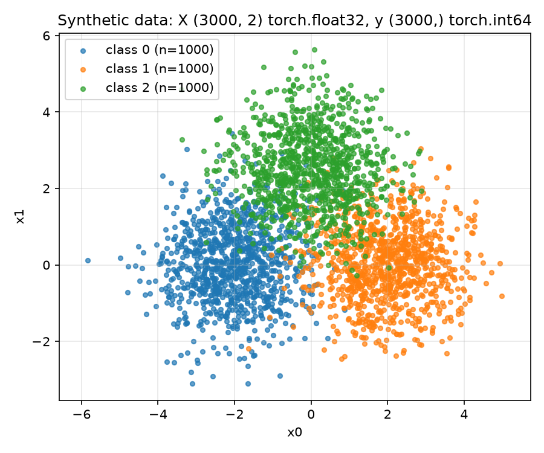
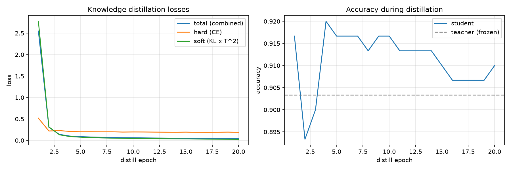

# Knowledge Distillation

End-to-end knowledge distillation demo with a mock teacher (large MLP) and student (small MLP) on a synthetic 2D 3-class dataset.

## Method (Hinton et al., 2015)

`train_knowledge_distillation()` in `train_kd.py` follows Section 2 of *Distilling the Knowledge in a Neural Network*, with the paper's notation (`v`: teacher logits, `z`: student logits):

- Soft loss: `T^2 * KL(p || q)` via `F.kl_div`, with `p = softmax(v / T)`, `q = softmax(z / T)`. This is the paper's soft cross-entropy minus the teacher entropy `H(p)`, which does not depend on the student. Teacher is frozen and both use `T = 3.0`. The `T^2` factor compensates for the `1/T^2` shrinking of soft-target gradients (Eqs. 2–4).
- Hard loss: standard cross-entropy of `z` at `T = 1` against true labels.
- Combined loss: `(1 - alpha) * soft + alpha * hard` with `alpha = 0.1`.

## On-policy distillation

`--method on-policy` keeps the same loop, temperature, and hard-label term, and replaces the soft objective with reverse KL under the student. That is the loss in Agarwal et al. (2024) at student-data fraction λ = 1, and the per-token reverse KL in Thinking Machines Lab (2025):

- Soft loss: `T^2 * KL(q || p)`, `q = softmax(z / T)`, `p = softmax(v / T)`.
- `KL(q || p) = E_{y ~ q}[log q(y) - log p(y)]`. With 3 classes this expectation is a sum, not a sample. A language-model trainer estimates the same quantity by sampling a token from the student and scoring it with the teacher.
- The input `x` is still the dataset point. This classifier is one step, so a sampled class does not move a later state.

```bash
$ uv run python train_kd.py --method on-policy
```

The chart is written to `on_policy_training_curve.png`. `alpha = 0` drops the hard-label term, which is how the language-model recipes usually run this loss.

## Run

```bash
$ uv sync
$ uv run python train_kd.py
```

## Data

`make_synthetic_data()` generates 3 Gaussian blobs in 2D, one per class:

- `X`: `(3000, 2)`, `torch.float32` — 2D coordinates, centers at `[-2, 0]`, `[2, 0]`, `[0, 2.5]` with std 1.
- `y`: `(3000,)`, `torch.int64` — class labels 0/1/2, 1000 samples each.



## Result



## Reference

- Geoffrey Hinton, Oriol Vinyals, Jeff Dean. *Distilling the Knowledge in a Neural Network.* arXiv:1503.02531, 2015. [arXiv](https://arxiv.org/abs/1503.02531)
- Rishabh Agarwal, Nino Vieillard, Yongchao Zhou, Piotr Stanczyk, Sabela Ramos, Matthieu Geist, Olivier Bachem. *On-Policy Distillation of Language Models: Learning from Self-Generated Mistakes.* ICLR 2024. [arXiv](https://arxiv.org/abs/2306.13649)
- Thinking Machines Lab. *On-Policy Distillation.* 2025. [blog](https://thinkingmachines.ai/blog/on-policy-distillation/)
